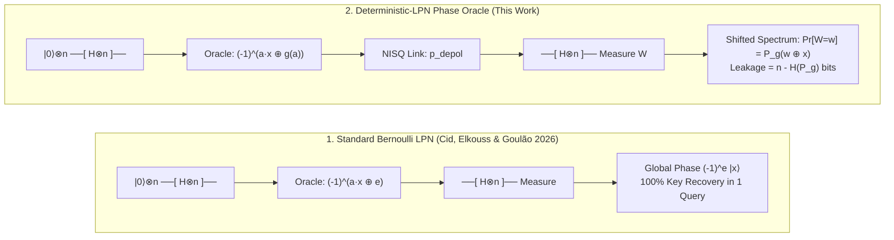
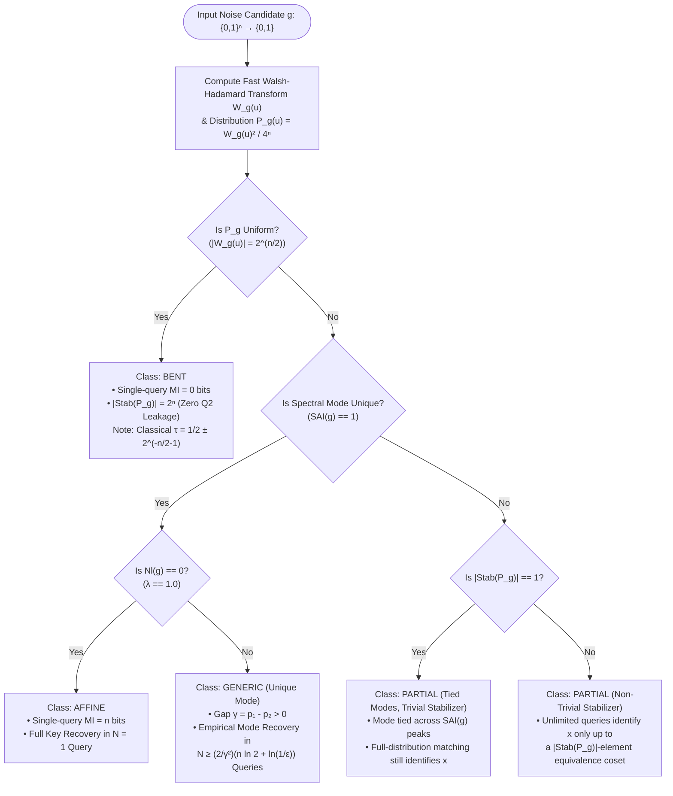
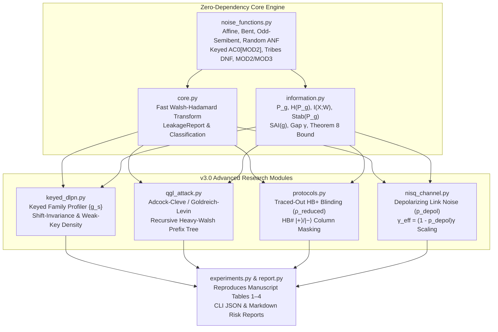

# AegisGuard-Q (v3.0)

[](https://doi.org/10.5281/zenodo.21934507)
[](https://www.python.org/)
[](#verification--test-suite)
[](#license)

**Quantum-Leakage Static Analysis & NISQ Superposition Profiler for Deterministic-LPN Authentication Protocols.**

`AegisGuard-Q` takes a deterministic Boolean noise function $g: \lbrace 0,1 \rbrace^n \to \lbrace 0,1 \rbrace$ (or a secret-keyed family $g_s$) and computes, **exactly**, what a quantum chosen-message (**Q2**) adversary learns about the secret key $x$ of an HB-style authentication protocol:
1. **Single-Query Leakage:** How many bits of $x$ leak in one Bernstein–Vazirani (BV) superposition query ($I(X;W) = n - H(P_g)$).
2. **Multi-Query Identifiability:** Whether unlimited queries uniquely identify $x$ or trap the adversary in a coset of the translation stabilizer $\mathrm{Stab}(P_g)$.
3. **Finite-Sample & NISQ Complexity:** How many queries $N$ are required to overcome both spectral ambiguity ($\gamma$) and physical quantum link decoherence ($p_{\mathrm{depol}}$).
4. **Keyed DLPN & QGL Vulnerability:** Weak-key density across keyed $\mathrm{AC}^0[\mathrm{MOD}_2]$, *Tribes* DNF, and mixed-modulus weak PRFs under Quantum Goldreich–Levin (QGL) extraction.

Accompanies the manuscript ***Spectral Characterization of Superposition Leakage in Deterministic-LPN Authentication Protocols*** (Version 2.0, November 2026), [DOI: 10.5281/zenodo.21934507](https://doi.org/10.5281/zenodo.21934507) (`paper.tex` / `paper.pdf`). This README follows the manuscript's order: spectral shift, information-theoretic leakage, identifiability, finite-sample recovery, the noise-density trade-off, extensions, experiments, artifact, and limitations.

---

## Visual Intuition: Why Bernoulli Noise Fails & How Deterministic Noise Behaves

In standard LPN-based authentication (**HB**, **HB+**, **HB#**), Cid, Elkouss & Goulão (*IACR CiC* 2026) showed that independently sampled Bernoulli noise $e \leftarrow \mathrm{Ber}(\tau)$ factors out as an **unobservable global phase** $(-1)^e$ during a coherent superposition query. When noise is instead a deterministic function $g(a)$ of the query register $\vert{}a\rangle$, it stays entangled with the computational basis and **convolves** the measurement outcome with the squared Walsh spectrum $P_g(u) = W_g(u)^2 / 4^n$:



### The Spectral Shift Phenomenon (Lemma 1 & Theorem 2)

Measuring the phase oracle $O_{x,g}\vert{}a\rangle = (-1)^{a\cdot x \oplus g(a)}\vert{}a\rangle$ in the Hadamard basis produces outcome $w$ with probability $P_g(w \oplus x)$. The secret $x$ simply **translates** the noise spectrum $P_g$ across $\mathbb{F}_2^n$ without changing its shape:

```text
Case A: Affine Noise g(a) = a·s ⊕ c          Case B: Random Unique-Mode Noise (n=6)          Case C: Bent Noise g(a) (Even n)
(Point-Mass Spectrum: λ = 1.0, γ = 1.0)      (Peaked Spectrum: λ = 0.3438, γ = 0.0391)       (Flat Spectrum: λ = 2^(-n/2), γ = 0)

  P_g(w ⊕ x)                                   P_g(w ⊕ x)                                      P_g(w ⊕ x)
  1.00 │       █                               0.12 │       █  <-- Mode w* = x ⊕ u*            0.06 │ ▄▄▄▄▄▄▄▄▄▄▄▄▄▄▄▄▄▄▄▄
  0.75 │       █                               0.09 │       █      (Gap γ = p1 - p2)           0.04 │ ████████████████████
  0.50 │       █                               0.06 │   █   █   █                              0.02 │ ████████████████████
  0.25 │       █                               0.03 │ ▄ █ ▄ █ █ █ ▄ ▄                          0.00 └────────────────────► w
  0.00 └───────┴───────► w                     0.00 └─┴─┴─┴─┴─┴─┴─┴─┴─► w                           Uniform over all 2^n states
        w* = x ⊕ s                                   Recovered in N ~ O(n/γ²) queries               I(X;W) = 0 bits, |Stab| = 2^n
  Leakage: n bits (1 query)                    Leakage: 1.0041 bits (N ≤ 9378)                 Leakage: 0 bits (Unidentifiable)
```

---

## Summary of Theoretical Results

All results hold for a known deterministic $g$ in the Q2 phase-oracle model. The numbering is shared with the manuscript.

| Result | Formal Statement | Operational Meaning |
|---|---|---|
| **Lemma 1** (Walsh Shift) | $W_h(w) = W_g(w \oplus x) \implies \Pr[W = w \mid X = x] = P_g(w \oplus x)$ | The secret key $x$ shifts the noise spectrum without altering its shape. |
| **Theorem 2** (Exact Leakage) | $I(X;W) = n - H(P_g)$ bits | Single-query mutual information equals $n$ minus the spectral Shannon entropy. |
| **Corollary 3** (Affine Endpoint) | $g(a) = a\cdot s \oplus c \implies I(X;W) = n$ | Affine noise collapses $P_g$ to a point mass; 1 query recovers $x$. |
| **Corollary 4** (Bent Endpoint) | $\Vert{}W_g(u)\Vert{} = 2^{n/2} \implies I(X;W) = 0$ | Bent functions (even $n$) produce uniform $P_g$ and leak 0 bits. |
| **Definition 5** (Stabilizer) | $\mathrm{Stab}(P_g) = \lbrace t : P_g(u) = P_g(u \oplus t)\ \forall u \rbrace$ | The translation symmetry group of the spectral distribution. |
| **Definition 6** (SAI) | $\mathrm{SAI}(g) = \#\lbrace u : \Vert{}W_g(u)\Vert{} = \max_v \Vert{}W_g(v)\Vert{} \rbrace$ | The number of tied spectral maxima; distinct from $\vert{}\mathrm{Stab}(P_g)\vert{}$. |
| **Theorem 7** (Identifiability) | $P_{h_x} \equiv P_{h_{x'}} \iff x \oplus x' \in \mathrm{Stab}(P_g)$ | Unlimited queries uniquely identify $x$ **iff** $\mathrm{Stab}(P_g) = \lbrace 0 \rbrace$. |
| **Theorem 8** (Sample Bound) | $N \ge \frac{2}{\gamma^2}\left(n \ln 2 + \ln \frac{1}{\varepsilon}\right)$ | Queries needed for empirical mode $w^*$ to match $x \oplus u^*$ with prob $\ge 1-\varepsilon$. |
| **Theorem 9** (Trade-off) | $\Vert{}1 - 2\tau\Vert{} \le \lambda$, where $\lambda = \max_u \Vert{}W_g(u)\Vert{}/2^n$ | Flattening the spectrum ($\lambda \to 0$) forces noise density $\tau \to 1/2$. |

Normalization note: $\lambda = \max_u \Vert{}W_g(u)\Vert{}/2^n$ is an amplitude, while the largest measurement probability is $p_{\max} = \lambda^2$. The gap $\gamma = p_1 - p_2$ is a difference of probabilities.

---

## The Fundamental Design Tension (Theorem 9)

Why not always pick a **bent** function $g$ so that $I(X;W) = 0$? **Theorem 9** proves that the classical noise rate $\tau = \mathrm{wt}(g)/2^n$ is locked to the maximum normalized Walsh amplitude $\lambda = \max_u \vert{}W_g(u)\vert{}/2^n$:

$$\vert{}1 - 2\tau\vert{} \le \lambda \quad \Longleftrightarrow \quad \tau \in \left[\frac{1-\lambda}{2},\ \frac{1+\lambda}{2}\right]$$

```text
Classical Noise Rate τ = wt(g)/2^n
0.0 ───────────────────────────[═══════════════ Allowed Band ═══════════════]─────────────────────────── 0.5 (Random Guessing)
                               ▲                                            ▲
                     Low-Noise LPN (τ ≪ 0.5)                      Bent / Flat Spectrum (λ = 2^(-n/2))
                  Requires large λ ⇒ High Q2 Leakage!            Forces τ → 0.5 ⇒ Breaks Completeness!
```

> **The Catch-22:** Suppressing Q2 superposition leakage requires flattening the Walsh spectrum ($\lambda \to 0$), which mathematically forces the classical noise density $\tau \to 1/2$, destroying the protocol's classical completeness threshold!

This is a mathematical design tension, not a proof of security or insecurity for keyed deterministic-LPN protocols.

### Classification Procedure: Evaluating Any Deterministic Noise Candidate



---

## Extensions: Joint-Input and Hybrid Noise

- **Idealized joint-input oracle (Section 9):** The HB+ response $z = a\cdot x \oplus b\cdot y \oplus e$ is modeled as a $2n$-bit phase oracle $(-1)^{a\cdot x \oplus b\cdot y \oplus g(a,b)}$. With $\tilde{a} = (a,b)$ and $\tilde{x} = (x,y)$, the Walsh shift identity applies on $2n$ bits. This idealized oracle is not claimed to equal the physical Q2 interface of HB+.
- **Hybrid noise (Section 10):** For $e = g(a) \oplus r$ with $r$ sampled once per oracle call, the factor $(-1)^r$ is a global phase, so independent per-call Bernoulli noise does not change the Fourier-sampling distribution. This extends the global-phase mechanism of Cid, Elkouss & Goulão and is not a separate attack claim.

---

## Architecture of `AegisGuard-Q` v3.0



---

## Installation & Quick Start

The **core library has zero external dependencies** (pure Python 3.9+ standard library):

```bash
# Run directly via CLI (no install required)
python -m aegisguard_q.cli --family bent --n 8 --format markdown

# Install package + pytest/numpy verification dependencies
pip install -e ".[test]"      # or: pip install -r requirements.txt
```

**Python API Example:**

```python
from aegisguard_q import (
    analyze_noise_function, mutual_information,
    translation_stabilizer, noise_functions as nf, to_markdown,
)
from aegisguard_q.nisq_channel import noisy_channel_metrics

# 1. Analyze an 8-bit Maiorana-McFarland bent noise function
g_bent = nf.bent_inner_product(8)
print(to_markdown(analyze_noise_function(8, g_bent)))

# 2. Evaluate NISQ depolarizing link degradation on a 6-bit keyed PRF
g_prf = nf.keyed_mod2_mod3_prf(n=6, key_s=0b101101)
print("Noiseless MI:", mutual_information(6, g_prf), "bits")
print("At 10% Depolarizing Noise:", noisy_channel_metrics(6, g_prf, p_depol=0.10))
```

---

## Reproducing Manuscript Tables 1–4

Run the master experiment driver to regenerate all four tables and assert the closed-form predictions of Theorems 2, 8, and 9 on every row (the driver exits non-zero on any mismatch):

```bash
python experiments.py
```

Benchmark families are affine functions, Maiorana–McFarland bent functions (even $n$), seeded random Boolean functions, and odd-dimensional semibent functions obtained by extending a bent function on $n-1$ variables independently of the final bit. Pseudorandom instances use fixed seeds $10$, $2$, $10$ for $n = 4, 6, 8$; the $n = 6$ seed was selected so that the instance has a unique spectral mode, the regime in which Theorem 8 applies.

### Table 1 — Exact Spectral Metrics Across Benchmark Families

| Family | $n$ | $\tau$ | $\lambda$ | $H(P_g)$ | $I(X;W)$ | $\Vert{}\mathrm{Stab}(P_g)\Vert{}$ | $\mathrm{SAI}(g)$ | $\gamma$ | Visual Leakage Ratio ($I/n$) |
|---|---:|---:|---:|---:|---:|---:|---:|---:|---|
| **Affine** | 4 | 0.5000 | 1.0000 | 0.0000 | **4.0000** | 1 | 1 | 1.0000 | `██████████ 100%` |
| **Bent** | 4 | 0.3750 | 0.2500 | 4.0000 | **0.0000** | 16 | 16 | 0 | `░░░░░░░░░░ 0%` |
| **Random** | 4 | 0.3750 | 0.5000 | 3.0000 | **1.0000** | 2 | 2 | 0 | `██▌░░░░░░░ 25%` |
| **Affine** | 6 | 0.5000 | 1.0000 | 0.0000 | **6.0000** | 1 | 1 | 1.0000 | `██████████ 100%` |
| **Bent** | 6 | 0.4375 | 0.1250 | 6.0000 | **0.0000** | 64 | 64 | 0 | `░░░░░░░░░░ 0%` |
| **Random** | 6 | 0.5156 | 0.3438 | 4.9959 | **1.0041** | 1 | 1 | 0.0391 | `█▋░░░░░░░░ 17%` |
| **Affine** | 8 | 0.5000 | 1.0000 | 0.0000 | **8.0000** | 1 | 1 | 1.0000 | `██████████ 100%` |
| **Bent** | 8 | 0.4688 | 0.0625 | 8.0000 | **0.0000** | 256 | 256 | 0 | `░░░░░░░░░░ 0%` |
| **Random** | 8 | 0.4453 | 0.1875 | 6.8601 | **1.1399** | 1 | 1 | 0.0056 | `█▍░░░░░░░░ 14%` |
| **Odd-semibent** | 3 | 0.2500 | 0.5000 | 2.0000 | **1.0000** | 4 | 4 | 0 | `███▎░░░░░░ 33%` |
| **Odd-semibent** | 5 | 0.3750 | 0.2500 | 4.0000 | **1.0000** | 16 | 16 | 0 | `██░░░░░░░░ 20%` |
| **Odd-semibent** | 7 | 0.4375 | 0.1250 | 6.0000 | **1.0000** | 64 | 64 | 0 | `█▍░░░░░░░░ 14%` |

### Table 2 — Monte-Carlo Empirical Mode Failure (Seeded Random $n=6$, $\gamma=0.0390625$, $\varepsilon=0.05$)

Direct multinomial simulation, 3,000 trials per row, generator seed $20260814$.

| Queries $N$ | Empirical Failure Rate | Convergence vs. Theorem 8 Union Bound ($N \ge 9,378$) |
|---:|---:|---|
| 250 | `0.0963` (9.63%) | `██████████░░░░░░░░░░` (Above $\varepsilon = 0.05$) |
| 500 | `0.0273` (2.73%) | `███░░░░░░░░░░░░░░░░░` (Drops below $\varepsilon = 0.05$) |
| 1,000 | `0.0003` (0.03%) | `▏░░░░░░░░░░░░░░░░░░░` |
| 2,000 | `0.0003` (0.03%) | `▏░░░░░░░░░░░░░░░░░░░` |
| 5,000 | `0.0000` (0.00%) | `░░░░░░░░░░░░░░░░░░░░` (Zero empirical failures) |
| **9,378** | **`0.0000` (0.00%)** | `░░░░░░░░░░░░░░░░░░░░` (**Provable Theorem 8 Union Bound**) |

### Table 3 — Keyed Deterministic-LPN ($g_s$) Family Profiles ($n=6$, $s \in \lbrace 1, \ldots, 63 \rbrace$)

| Keyed Family | Mean $\tau$ | Mean MI | Min / Max MI | Unique-Mode Fraction | Weak Keys ($\lambda \ge 0.5$) | Key-Spectrum Behavior |
|---|---:|---:|---:|---:|---:|---|
| `keyed_ac0_mod2_prf` (`mask_t=3`) | 0.5119 | 4.0000 | 4.0000 / 4.0000 | 0.0000 | **63 / 63** | Shift-invariant spectrum; heavy Walsh peaks |
| `keyed_tribes_dlpn` (`width=2`) | 0.5781 | 1.3790 | 1.3790 / 1.3790 | 0.0000 | **0 / 63** | Shift-invariant spectrum; no $\lambda \ge 0.5$ weak keys |
| `keyed_mod2_mod3_prf` | 0.1719 | 4.1132 | 1.3031 / 6.0000 | **0.6667** (42 / 63) | **41 / 63** | Strongly $\mathrm{wt}(s)$-dependent; 66.67% unique mode |

The mixed-modulus family is $g_s(a) = ((\mathrm{wt}(a \wedge s) \bmod 2) + (\mathrm{wt}(a \wedge s) \bmod 3)) \bmod 2$. The `qgl_attack.py` module applies recursive Adcock–Cleve/Goldreich–Levin prefix pruning to isolate heavy Walsh candidates and intersects candidate shifts across rotated-key sessions.

### Table 4 — NISQ Depolarizing Channel Degradation (Seeded Random $n=6$, $\varepsilon=0.05$)

Under a global depolarizing channel $\mathcal{E}_{p_{\mathrm{depol}}}(\rho) = (1 - p_{\mathrm{depol}})\rho + p_{\mathrm{depol}} I/2^n$, the measurement distribution becomes $P_{g,p_{\mathrm{depol}}}(u) = (1 - p_{\mathrm{depol}})P_g(u) + p_{\mathrm{depol}}/2^n$. The effective spectral gap shrinks linearly as $\gamma_{\mathrm{eff}} = (1 - p_{\mathrm{depol}})\gamma$, causing the required sample bound $N \propto 1/\gamma_{\mathrm{eff}}^2$ to grow quadratically:

| Depolarizing Rate $p_{\mathrm{depol}}$ | Degraded $I_{\mathrm{depol}}(X;W)$ | Effective Gap $\gamma_{\mathrm{eff}}$ | Theorem 8 Sample Bound $N$ | Relative Query Inflation |
|---:|---:|---:|---:|---|
| `0.00` (Ideal Q2) | 1.0041 bits | 0.0390625 | **9,378** | `██▌░░░░░░░ 1.00x` |
| `0.05` (5% Noise) | 0.8929 bits | 0.0371094 | **10,391** | `██▊░░░░░░░ 1.11x` |
| `0.10` (10% Noise) | 0.7946 bits | 0.0351563 | **11,578** | `███░░░░░░░ 1.23x` |
| `0.25` (25% Noise) | 0.5493 bits | 0.0292969 | **16,672** | `████▍░░░░░ 1.78x` |
| `0.50` (50% Noise) | 0.2533 bits | 0.0195313 | **37,511** | `██████████ 4.00x` |

---

## Verification & Test Suite

```bash
python -m pytest tests/ -q      # 32 passed
python experiments.py           # Regenerates Tables 1–4 + asserts Theorems 2, 8, 9
python verify_theorem2.py       # Standalone empirical-mode bound verification
```

| Test Module | Coverage |
|---|---|
| `tests/test_core.py` | Parseval's identity, affine/bent closed-form identities, and floating-point cross-validation against an independent NumPy statevector simulator |
| `tests/test_information.py` | $I(X;W) = n - H(P_g)$, stabilizer subgroup closure, odd-semibent 1-bit leakage, Theorem 8 ($N=9,378$) and Theorem 9 ($\Vert{}1-2\tau\Vert{} \le \lambda$) |
| `tests/test_hbplus.py` | Idealized $2n$-bit joint-input $\mathrm{HB}^+$ phase-oracle extension |
| `tests/test_v3_modules.py` | Keyed DLPN shift invariance & weak-key profiling, QGL prefix-tree pruning, traced-out $\mathrm{HB}^+$ & multi-column $\mathrm{HB}^{\sharp}$ masking, and NISQ depolarizing limits ($p_{\mathrm{depol}} \in \lbrace 0, 1 \rbrace$) |

Reported figures were produced with Python 3.12.3, NumPy 2.4.4 and pytest 9.1.1 on Linux, and were independently reproduced without modification on Windows under Python 3.14.5 with NumPy 2.4.4 and pytest 9.1.1. Exact spectrum computation is exponential in $n$; the artifact is intended for verification and small/medium benchmark instances, not scalable cryptanalysis.

---

## Scope and Limitations

- **Known-g vs. Keyed-g_s:** A public deterministic $g$ is classically trivial ($a\cdot x = z \oplus g(a)$). The known-$g$ oracle serves as an exact mathematical laboratory for Q2 spectral leakage. Version 3.0 profiles finite **keyed** families ($g_s$), while asymptotic classical hardness proofs for keyed DLPN remain open.
- **Statistical Upper Bound:** Theorem 8 is a finite-sample sufficiency bound via Hoeffding's inequality, assuming independent non-adaptive measurements; polynomial-query complexity requires $\gamma \ge 1/\mathrm{poly}(n)$.
- **Protocol Interface:** Section 9 of the manuscript analyzes an idealized $2n$-bit joint phase oracle for $\mathrm{HB}^+$, while `protocols.py` models traced-out Prover blinding entanglement and $\mathrm{HB}^{\sharp}$ column masking. Full coherent rewinding proofs, adaptive attacks, and concrete protocol completeness/error rates remain future work.
- **Novelty:** No priority claim is made. Independent verification by a subject-area specialist remains appropriate.

---

## Citing

Please cite **both** the software artifact and the manuscript:

> **Kumar, J.** (2026). *AegisGuard-Q: Quantum-leakage static analysis for deterministic-LPN noise functions* (Version 3.0) [Computer software]. https://github.com/jayant-kumar-dev/Aegisguard-Q

> **Kumar, J.** (2026). *Spectral Characterization of Superposition Leakage in Deterministic-LPN Authentication Protocols* (Version 2.0). Zenodo. https://doi.org/10.5281/zenodo.21934507

Foundational reference:
> **Cid, C., Elkouss, D., & Goulão, M.** (2026). Superposition Attacks Against LPN-Based Authentication Protocols. *IACR Communications in Cryptology*, 3(1):17. https://doi.org/10.62056/abhey7n4e

---

## License

MIT License.
