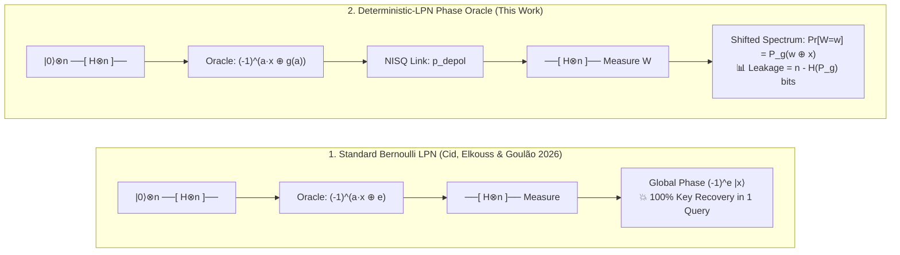

# 🛡️ AegisGuard-Q (v3.0)

[](https://doi.org/10.5281/zenodo.21934507)
[](https://www.python.org/)
[](#tests)
[](#license)

**Quantum-Leakage Static Analysis & NISQ Superposition Profiler for Deterministic-LPN Authentication Protocols.**

`AegisGuard-Q` takes a deterministic Boolean noise function $g: \{0,1\}^n \to \{0,1\}$ (or a secret-keyed family $g_s$) and computes, **exactly**, what a quantum chosen-message (**Q2**) adversary learns about the secret key $x$ of an HB-style authentication protocol:
1. **Single-Query Leakage:** How many bits of $x$ leak in one Bernstein–Vazirani (BV) superposition query ($I(X;W) = n - H(P_g)$).
2. **Multi-Query Identifiability:** Whether unlimited queries uniquely identify $x$ or trap the adversary in a coset of the translation stabilizer $\mathrm{Stab}(P_g)$.
3. **Finite-Sample & NISQ Complexity:** How many queries $N$ are required to overcome both spectral ambiguity ($\gamma$) and physical quantum link decoherence ($p_{\mathrm{depol}}$).
4. **Keyed DLPN & QGL Vulnerability:** Weak-key density across keyed $\mathrm{AC}^0[\mathrm{MOD}_2]$, *Tribes* DNF, and mixed-modulus weak PRFs under Quantum Goldreich–Levin (QGL) extraction.

Accompanies the manuscript ***Spectral Characterization of Superposition Leakage in Deterministic-LPN Authentication Protocols*** (Version 2.0, November 2026), [DOI: 10.5281/zenodo.21934507](https://doi.org/10.5281/zenodo.21934507) (`paper.tex` / `paper.pdf`).

---

## 🔬 Visual Intuition: Why Bernoulli Noise Fails & How Deterministic Noise Behaves

In standard LPN-based authentication (**HB**, **HB+**, **HB#**), Cid, Elkouss & Goulão (*IACR CiC* 2026) showed that independently sampled Bernoulli noise $e \leftarrow \mathrm{Ber}(\tau)$ factors out as an **unobservable global phase** $(-1)^e$ during a coherent superposition query. When noise is instead a deterministic function $g(a)$ of the query register $\vert{}a\rangle$, it stays entangled with the computational basis and **convolves** the measurement outcome with the squared Walsh spectrum $P_g(u) = W_g(u)^2 / 4^n$:



### The Spectral Shift Phenomenon (Lemma 1 & Theorem 2)

Measuring the phase oracle $O_{x,g}\vert{}a\rangle = (-1)^{a\cdot x \oplus g(a)}\vert{}a\rangle$ in the Hadamard basis produces outcome $w$ with probability $P_g(w \oplus x)$. The secret $x$ simply **translates** the noise spectrum $P_g$ across $\mathbb{F}_2^n$ without changing its shape:

```text
Case A: Affine Noise g(a) = a·s ⊕ c          Case B: Random Unique-Mode Noise (n=6)          Case C: Bent Noise g(a) (Even n)
(Point-Mass Spectrum: λ = 1.0, γ = 1.0)      (Peaked Spectrum: λ = 0.3438, γ = 0.0391)       (Flat Spectrum: λ = 2^(-n/2), γ = 0)

  P_g(w ⊕ x)                                   P_g(w ⊕ x)                                      P_g(w ⊕ x)
  1.00 │       █                               0.12 │       █  <-- Mode w* = x ⊕ u*            0.06 │ ▄▄▄▄▄▄▄▄▄▄▄▄▄▄▄▄▄▄▄▄
  0.75 │       █                               0.09 │       █      (Gap γ = p1 - p2)           0.04 │ ████████████████████
  0.50 │       █                               0.06 │   █   █   █                              0.02 │ ████████████████████
  0.25 │       █                               0.03 │ ▄ █ ▄ █ █ █ ▄ ▄                          0.00 └────────────────────► w
  0.00 └───────┴───────► w                     0.00 └─┴─┴─┴─┴─┴─┴─┴─┴─► w                           Uniform over all 2^n states
        w* = x ⊕ s                                   Recovered in N ~ O(n/γ²) queries               I(X;W) = 0 bits, |Stab| = 2^n
  👉 Leakage: n bits (1 query)                 👉 Leakage: 1.0041 bits (N ≤ 9378)              👉 Leakage: 0 bits (Unidentifiable)
```

---

## ⚖️ The Fundamental Design Tension (Theorem 9)

Why not always pick a **bent** function $g$ so that $I(X;W) = 0$? **Theorem 9** proves that the classical noise rate $\tau = \mathrm{wt}(g)/2^n$ is locked to the maximum normalized Walsh amplitude $\lambda = \max_u \vert{}W_g(u)\vert{}/2^n$:

$$\vert{}1 - 2\tau\vert{} \le \lambda \quad \Longleftrightarrow \quad \tau \in \left[\frac{1-\lambda}{2},\ \frac{1+\lambda}{2}\right]$$

```text
Classical Noise Rate τ = wt(g)/2^n
0.0 ───────────────────────────[═══════════════ Allowed Band ═══════════════]─────────────────────────── 0.5 (Random Guessing)
                               ▲                                            ▲
                     Low-Noise LPN (τ ≪ 0.5)                      Bent / Flat Spectrum (λ = 2^(-n/2))
                  Requires large λ ⇒ High Q2 Leakage!            Forces τ → 0.5 ⇒ Breaks Completeness!
```

> **The Catch-22:** Suppressing Q2 superposition leakage requires flattening the Walsh spectrum ($\lambda \to 0$), which mathematically forces the classical noise density $\tau \to 1/2$, destroying the protocol's classical completeness threshold!

---

## 🧭 Decision Flowchart: Evaluating Any Deterministic Noise Candidate
